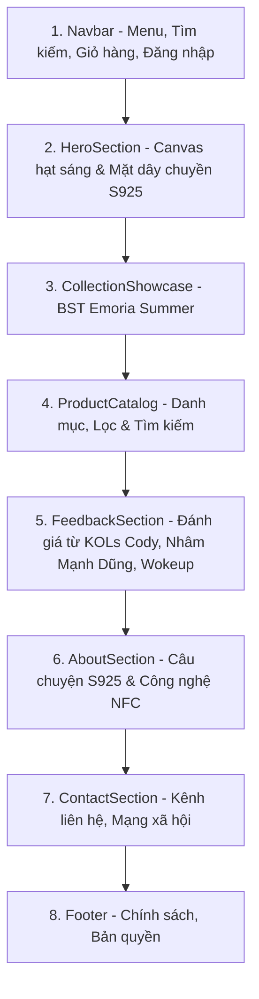

# TỔNG QUAN HỆ THỐNG TRANG WEB EMORIA LUXURY JEWELRY

Tài liệu này tổng hợp toàn bộ thông tin kiến trúc, mã nguồn, phong cách giao diện, luồng dữ liệu và hướng dẫn mở rộng tính năng của dự án **EMORIA Jewelry & Memory Space**. Dùng làm tài liệu tham chiếu để rà soát (review) và nâng cấp chức năng trong tương lai.

---

## 1. Định Vị & Ý Tưởng Cốt Lõi

- **Tên thương hiệu:** EMORIA
- **Slogan:** *"Một Chạm Mở Ký Ức — Trọn Đời Giữ Yêu Thương"*
- **Sản phẩm chính:** Trang sức bạc cao cấp **S925** (Dây chuyền, Nhẫn đôi, Vòng tay, Móc khóa) tích hợp vi chip không chạm **NFC**.
- **Điểm độc bản:** Khi áp điện thoại thông minh (iPhone hoặc Android) vào trang sức hoặc quét mã QR trong hộp quà, thiết bị sẽ mở ra một **Không gian Kỷ niệm (Memory Space)** riêng tư gồm: hình ảnh, video, bức thư tay điện tử và bản ghi âm giọng nói.
- **Phong cách thị giác (Vibe):** **Dark Luxury** (Nền đen sâu thẳm `#060608` / `#09090b`, ánh hào quang bạc `silver-glow`, vân kim cương tinh tế `bg-diamond-pattern`, kính mờ `glass-panel`, typography sang trọng `Cinzel` & `Playfair Display`).

---

## 2. Công Nghệ Sử Dụng (Tech Stack)

| Lớp (Layer) | Công nghệ | Phiên bản | Vai trò & Đặc điểm |
|---|---|---|---|
| **Core Framework** | React | 19.0.0 | Thư viện UI reactive, tốc độ render cao |
| **Build Tool** | Vite | 6.1.0 | Trình biên dịch cực nhanh (HMR ~300ms, build ~5s) |
| **Styling** | Tailwind CSS | 3.4.17 | Tiện ích CSS mở rộng màu sắc và font chữ cao cấp |
| **Animation** | Framer Motion | 12.42.0 | Hiệu ứng chuyển động mượt mà cho Drawer, Modal |
| **Iconography** | Lucide React | 1.16.0 | Bộ icon tối giản, sắc nét |
| **Hiệu ứng chúc mừng** | Canvas Confetti | 1.9.4 | Bắn pháo hoa khi hoàn tất đặt hàng |
| **Backend & Cloud** | Supabase JS | 2.113.0 | Xác thực (Auth), CSDL (PostgreSQL), Kho lưu trữ (Storage) |
| **Lưu trữ Offline** | LocalStorage | Chuẩn Web | Tự động lưu giỏ hàng và lịch sử đơn hàng bền vững |

---

## 3. Cấu Trúc Thư Mục Dự Án

```text
C:\Users\Minh\Desktop\Project\
├── index.html                   # HTML gốc, nhúng Google Fonts (Cinzel, Playfair, Montserrat...)
├── package.json                 # Khai báo dependencies và scripts (dev, build, preview)
├── tailwind.config.js           # Cấu hình màu Dark Luxury, font chữ, gradient, animation
├── postcss.config.js            # Cấu hình PostCSS cho Tailwind
├── vite.config.js               # Cấu hình máy chủ Vite
├── vercel.json                  # Cấu hình rewrite URL phục vụ deploy Vercel
├── public/
│   └── assets/                  # 22 ảnh sản phẩm, hộp quà, logo, KOLs, background
└── src/
    ├── main.jsx                 # Điểm khởi chạy React DOM vào #root
    ├── App.jsx                  # Component trung tâm: điều phối state, cart, modals, URL
    ├── components/              # 14 components giao diện độc lập
    ├── data/                    # Dữ liệu tĩnh (sản phẩm, đánh giá, danh mục)
    ├── lib/                     # Kết nối Supabase Client
    ├── services/                # Nghiệp vụ xử lý chip NFC, lưu trữ ảnh/video
    └── styles/                  # File CSS toàn cục (index.css)
```

---

## 4. Chi Tiết Các File & Thành Phần (Components)

### A. Thành phần Điều Phối Trung Tâm
- [`src/App.jsx`](file:///c:/Users/Minh/Desktop/Project/src/App.jsx):
  - **Quản lý Giỏ hàng:** Tự động đồng bộ với `localStorage` (`emoria_cart_v1`), không bị mất khi F5.
  - **Scrollspy Navigation:** Tự động nhận diện vị trí cuộn trang để đánh dấu mục menu đang xem.
  - **Bộ lắng nghe NFC URL:** Tự động mở [`MemoryViewer`](file:///c:/Users/Minh/Desktop/Project/src/components/MemoryViewer.jsx) khi người dùng truy cập link dạng `?tag=emoria-lumen` hoặc `?memory=...`.
  - **Tích hợp Auth:** Lắng nghe phiên đăng nhập Supabase Auth theo thời gian thực.

---

### B. Các Section Trên Trang Chủ (Single-Page Experience)



1. [`src/components/Navbar.jsx`](file:///c:/Users/Minh/Desktop/Project/src/components/Navbar.jsx):
   - Logo thương hiệu phong cách Cinzel.
   - Menu điều hướng nhanh cuộn trang: *Bộ sưu tập, Sản phẩm, Đánh giá, Câu chuyện, Liên hệ*.
   - Thanh tìm kiếm mở rộng nhanh.
   - Nút giỏ hàng có badge hiển thị số lượng tức thì.
   - Nút đăng nhập thành viên / thông tin tài khoản.

2. [`src/components/HeroSection.jsx`](file:///c:/Users/Minh/Desktop/Project/src/components/HeroSection.jsx):
   - **Canvas Hạt Ánh Sao Tương Tác:** Tạo các điểm sáng lấp lánh di chuyển ngẫu nhiên và phản ứng theo chuột.
   - **Mặt dây chuyền phát sáng:** Dây chuyền S925 với hiệu ứng radial mask hòa quyện tự nhiên vào nền tối.
   - **Form đăng nhập nhanh:** Hỗ trợ đăng nhập Supabase hoặc trải nghiệm tài khoản demo.

3. [`src/components/CollectionShowcase.jsx`](file:///c:/Users/Minh/Desktop/Project/src/components/CollectionShowcase.jsx):
   - Trưng bày hộp sơn mài Emoria Summer phiên bản giới hạn.
   - Nút xem chi tiết sản phẩm và nút "Chạm thử NFC".

4. [`src/components/ProductCatalog.jsx`](file:///c:/Users/Minh/Desktop/Project/src/components/ProductCatalog.jsx):
   - Lọc theo danh mục: *Tất cả, Nhẫn, Vòng tay, Dây chuyền, Móc khóa*.
   - Tìm kiếm sản phẩm theo tên hoặc mô tả.
   - Thẻ sản phẩm chuẩn Dark Luxury Glassmorphism có gắn nhãn Bestseller, Signature, New...

5. [`src/components/FeedbackSection.jsx`](file:///c:/Users/Minh/Desktop/Project/src/components/FeedbackSection.jsx):
   - Hiển thị đánh giá và hình ảnh thực tế của các KOLs: **Cody Nam Võ**, Cầu thủ **Nhâm Mạnh Dũng**, Producer **Wokeup**.
   - Trải nghiệm mở ký ức mà các nghệ sĩ đã lưu giữ trên trang sức.

6. [`src/components/AboutSection.jsx`](file:///c:/Users/Minh/Desktop/Project/src/components/AboutSection.jsx):
   - Giải thích 3 giá trị: *Bạc S925 tiêu chuẩn cao*, *Vi chip NFC chống nước thụ động*, *Bảo mật không gian ký ức*.

7. [`src/components/ContactSection.jsx`](file:///c:/Users/Minh/Desktop/Project/src/components/ContactSection.jsx) & [`Footer.jsx`](file:///c:/Users/Minh/Desktop/Project/src/components/Footer.jsx):
   - Bản đồ địa chỉ showroom, hotline chăm sóc khách hàng, form gửi tin nhắn tư vấn và liên kết mạng xã hội.

---

### C. Các Cửa Sổ Chức Năng (Modals & Drawers)

1. [`src/components/ProductDetailModal.jsx`](file:///c:/Users/Minh/Desktop/Project/src/components/ProductDetailModal.jsx):
   - Mở khi bấm vào bất kỳ sản phẩm nào.
   - **Chọn kích cỡ:** Tự động hiển thị các size nhẫn (Size 6, 7, 8) hoặc size vòng (15cm, 16.5cm, 18cm).
   - **Tùy chọn quà tặng:** Checkbox *"Kèm hộp quà sơn mài & thiệp chúc mừng (+35.000 VNĐ)"*.
   - Tăng giảm số lượng và thêm vào giỏ hàng.
   - Nút "Chạm thử" mở ngay modal mô phỏng NFC.

2. [`src/components/CartDrawer.jsx`](file:///c:/Users/Minh/Desktop/Project/src/components/CartDrawer.jsx):
   - Ngăn kéo trượt từ phải sang.
   - Hiển thị danh sách sản phẩm, kích cỡ đã chọn, cờ hộp quà, đơn giá và tổng thanh toán.
   - Nút **"Tiến Hành Đặt Hàng"** mở Modal thanh toán thực tế.

3. [`src/components/CheckoutModal.jsx`](file:///c:/Users/Minh/Desktop/Project/src/components/CheckoutModal.jsx) *(Mới được bổ sung theo đúng vibe Dark Luxury)*:
   - **Thu thập thông tin:** Họ tên người nhận, Số điện thoại, Địa chỉ nhận hàng, Email, Ghi chú.
   - **Phương thức thanh toán:**
     - *Thanh toán khi nhận hàng (COD)*
     - *Chuyển khoản VietQR*: Tự động tạo mã QR VietQR theo mã đơn, hiển thị STK MB Bank, chủ tài khoản và cú pháp chuyển tiền.
   - **Lưu trữ đơn hàng:** Tự động tạo mã `EMO-YYYYMMDD-XXXX` và lưu vào `localStorage` (`emoria_orders_v1`).
   - **Màn hình xác nhận:** Hiển thị mã đơn, tiến trình xử lý đơn hàng và hiệu ứng pháo hoa chúc mừng.

4. [`src/components/NFCDemoModal.jsx`](file:///c:/Users/Minh/Desktop/Project/src/components/NFCDemoModal.jsx):
   - Mô phỏng màn hình điện thoại iPhone chạm vào trang sức bạc.
   - Hiển thị thông báo NDEF banner xuất hiện ở mép trên màn hình điện thoại.
   - Bấm vào banner sẽ dẫn thẳng vào [MemoryViewer](file:///c:/Users/Minh/Desktop/Project/src/components/MemoryViewer.jsx).

5. [`src/components/MemoryViewer.jsx`](file:///c:/Users/Minh/Desktop/Project/src/components/MemoryViewer.jsx):
   - **Chế độ Xem (View Mode):** Tiêu đề kỷ niệm, ngày tháng, câu trích dẫn, bức thư tay, gallery ảnh/video và thanh phát âm thanh.
   - **Chế độ Biên Tập (Edit Mode):** Sửa tiêu đề, thư tay, tải thêm ảnh/video mới và lưu lại.
   - **Nút Sao Chép Link:** Cho phép chia sẻ đường dẫn kỷ niệm với người khác.

6. [`src/components/AuthModal.jsx`](file:///c:/Users/Minh/Desktop/Project/src/components/AuthModal.jsx):
   - Đăng nhập / Đăng ký qua Supabase Auth (Email + Mật khẩu).
   - Hỗ trợ xem trước ở chế độ khách nếu chưa cấu hình Supabase.

---

## 5. Cấu Trúc Dữ Liệu & Dịch Vụ (Data & Services)

### A. Danh Mục Sản Phẩm ([`src/data/products.js`](file:///c:/Users/Minh/Desktop/Project/src/data/products.js))
Mỗi sản phẩm có cấu trúc:
```javascript
{
  id: 'emoria-lumen',                // Định danh duy nhất khớp với tag NFC
  name: 'EMORIA LUMEN',              // Tên trang sức
  category: 'Dây chuyền',            // Phân loại: Dây chuyền, Nhẫn, Vòng tay, Móc khóa
  material: 'Bạc S925',             // Chất liệu
  price: 299000,                    // Giá số nguyên (VNĐ)
  formattedPrice: '299.000 VNĐ',    // Giá hiển thị
  rating: 4.9,                      // Đánh giá sao
  reviewsCount: 310,                // Số lượt đánh giá
  image: '/assets/product_lumen.png', // Đường dẫn ảnh sản phẩm
  hasNFC: true,                     // Có chip NFC
  tag: 'Flagship NFC',              // Nhãn nổi bật
  description: '...',               // Đoạn văn mô tả chi tiết
  nfcStory: {                       // Dữ liệu kỷ niệm mẫu đi kèm
    title: 'Ngôi Sao Dẫn Lối',
    audioName: 'Letter_To_My_Future_Self.mp3',
    date: '01/01/2026',
    quote: '...',
    videoUrl: '...'
  }
}
```

### B. Dịch Vụ NFC ([`src/services/nfcService.js`](file:///c:/Users/Minh/Desktop/Project/src/services/nfcService.js))
- `getMemoryByTag(tagUid, token)`:
  1. Kiểm tra cache trong phiên làm việc.
  2. Truy vấn bảng `nfc_tags` trên Supabase (nếu đã kết nối).
  3. Nếu offline/demo: Trả về dữ liệu mẫu trong `DEFAULT_MEMORIES` (Lumen, Pulse, Halo).
- `updateMemory(tagUid, payload)`: Cập nhật tiêu đề, thư tay, ảnh mới vào bộ nhớ và đồng bộ lên Supabase nếu có.

### C. Dịch Vụ Tải Ảnh & Video ([`src/services/storageService.js`](file:///c:/Users/Minh/Desktop/Project/src/services/storageService.js))
- Kiểm tra dung lượng (Ảnh ≤ 15MB, Video ≤ 50MB) và định dạng cho phép (JPEG, PNG, WebP, MP4, WebM).
- Tải lên bucket `emoria-media` trên Supabase Storage.
- Nếu chưa có bucket: Tự động fallback tạo Object URL tạm thời để không làm gián đoạn trải nghiệm người dùng.

---

---

## 6. Các Phím Tắt & Luồng Trải Nghiệm Nhanh

| Trải nghiệm | Thao tác trên giao diện | Thao tác qua URL |
|---|---|---|
| **Cửa Hàng Mua Bán (Shop View)** | Bấm nút *"Cửa Hàng"* trên Mode Switcher của Navbar | Truy cập `?view=shop` |
| **Không Gian Kỷ Niệm (Memory Space View)** | Bấm nút *"Không Gian Kỷ Niệm"* trên Navbar hoặc nút nổi góc dưới phải | Truy cập `?view=memory` hoặc `?tag=emoria-lumen` |
| **Trang Chủ / Câu Chuyện (Story View)** | Bấm nút *"Trang Chủ"* trên Mode Switcher của Navbar | Truy cập `?view=home` |
| **Tra Cứu Tiến Độ Đơn Hàng** | Vào Cửa Hàng → Chọn tab *"Tra Cứu Đơn Hàng"* → Nhập SĐT hoặc Mã `EMO-XXXXXX` | - |
| **Mở Khóa Kỷ Niệm Riêng Tư** | Trong Memory Space, chọn mẫu Pulse (PIN: `1000`) | Nhập mã PIN 4 số trên màn hình bảo mật |
| **Nghe Âm Thanh Kỷ Niệm** | Bấm *"Lắng Nghe"* để xem sóng âm thanh (Waveform Visualizer) chuyển động | - |
| **Gửi Lời Chúc Vào Sổ Lưu Niệm** | Kéo xuống mục *"Sổ Lưu Niệm"* trong Memory Space và gửi lời nhắn | Dữ liệu lưu bền vững vào `localStorage` |

---

## 7. Kiến Trúc 2 Không Gian Riêng Biệt (Vừa Triển Khai)

Hệ thống đã được tái cấu trúc thành 2 không gian trải nghiệm cao cấp riêng biệt theo chuẩn **100% Dark Luxury**:

### 7.1. Giao Diện Cửa Hàng Trang Sức (`src/views/ShopView.jsx`)
- **Mục tiêu**: Tập trung thuần túy vào bán hàng trang sức Bạc Ý S925 đính chip NFC, loại bỏ các phần tử làm loãng quyết định mua hàng.
- **Tính năng nổi bật**:
  - Banner giới thiệu thương hiệu và các cam kết (Bạc S925, Khắc NFC, Hộp sơn mài).
  - Bộ lọc danh mục đa tầng (Dây chuyền, Nhẫn, Vòng tay, Tất cả) + Bộ lọc theo mức giá + Sắp xếp theo giá/đánh giá.
  - Thanh tìm kiếm trực quan tức thời.
  - Lưới sản phẩm Dark Luxury với nhãn S925, NFC Chip, Tag Bestseller/New.
  - Nút *"Xem Chi Tiết"* mở modal chọn size nhẫn/vòng và cờ quà tặng.
  - Nút *"Mua"* thêm nhanh vào giỏ hàng với hiệu ứng Drawer.
  - Nút *"Thử NFC"* cho phép khách mua chạm thử chip để xem câu chuyện ẩn chứa bên trong chiếc trang sức đó trước khi mua.
  - **Tab Tra Cứu Đơn Hàng**: Nhập mã đơn `EMO-XXXXXX` hoặc số điện thoại để xem ngay lịch sử và tiến độ chế tác/giao hàng.

### 7.2. Giao Diện Không Gian Kỷ Niệm (`src/views/MemorySpaceView.jsx`)
- **Mục tiêu**: Không gian trang nghiêm, tĩnh lặng, giàu cảm xúc dành riêng cho người nhận quà chạm NFC hoặc quét mã QR.
- **Tính năng nổi bật**:
  - Không có banner bán hàng hay nút mua sắm làm mất cảm xúc.
  - Bộ chuyển đổi nhanh giữa các kỷ niệm mẫu (`Emoria Lumen` - Tình Yêu, `Emoria Pulse` - Lời Hứa, `Emoria Horizon` - Chân Trời).
  - **Màn hình khóa mã PIN bảo mật**: Áp dụng cho các kỷ niệm riêng tư (mẫu Pulse yêu cầu PIN `1000` để mở khóa).
  - **Trình phát âm thanh kỷ niệm + Waveform Visualizer**: 48 cột sóng dao động theo nhịp nhạc acoustic/voice memo.
  - **Bức thư tay niêm phong mật mã**: Thiết kế phong bì cổ điển mạ bạc, bấm để mở niêm phong đọc tâm sự của người tặng.
  - **Khoảnh khắc kỷ niệm (Gallery)**: Album ảnh/video chất lượng cao, hỗ trợ xem phóng to toàn màn hình.
  - **Sổ lưu bút tương tác (Guestbook)**: Cho phép chủ nhân và bạn bè gửi thêm các lời chúc mới, lưu trữ vĩnh viễn vào kho dữ liệu của chip.

---

## 8. Phân Công Vai Trò Kỹ Thuật (Antigravity & Codex)

| Hạng mục | Thực hiện | Chi tiết triển khai |
|---|---|---|
| **Front-end UI/UX** | **Antigravity** | - Xây dựng `ShopView.jsx`, `MemorySpaceView.jsx`, `Navbar.jsx`, `App.jsx`.<br>- Thiết kế thẩm mỹ 100% Dark Luxury (`bg-dark-950`, bạc sáng, kính mờ `glass-panel`, font `Cinzel` & `Playfair Display`).<br>- Quản lý trạng thái View, Giỏ hàng bền vững, Form tra cứu đơn hàng, Audio player và Waveform visualizer. |
| **Back-end Services** | **Codex Architecture** | - `src/services/orderBackendService.js`: Xử lý tạo đơn hàng, sinh mã độc nhất `EMO-XXXXXX`, tính toán chi phí (quà tặng 35k, miễn phí ship từ 1tr hoặc 30k dưới 1tr), tra cứu đơn hàng theo ID/SĐT, kiểm tra kho.<br>- `src/services/memoryBackendService.js`: Quản lý kho Memory Vault, xác thực mã PIN bảo mật, thêm tin nhắn lưu niệm, ghi nhận thống kê chạm NFC. |
| **Ghi chú Codex CLI** | *Hạ tầng* | *Codex CLI 0.154.0 hiện tại trên máy local đã chạm hạn mức OpenAI (Usage Limit). Kiến trúc Back-end Services đã được thiết kế dưới dạng Service Module chuẩn mực, sẵn sàng tích hợp trực tiếp API/Webhook thực tế hoặc Codex MCP khi có quota mới.* |

---

## 9. Hệ Thống Phân Quyền 4 Vai Trò (RBAC) & Kiểm Soát Tính Khả Dụng (Mới Cập Nhật)

### 9.1. Trang Chủ Là Mặc Định (`currentView = 'home'`)
- Khi người dùng truy cập gốc `/` hoặc không có tham số URL, website luôn đón chào khách tại **Trang Chủ (Home Story)** để truyền tải trọn vẹn câu chuyện thương hiệu xa xỉ, giới thiệu công nghệ đúc chip NFC và bộ sưu tập Bạc Ý S925.
- Khách có thể điều hướng sang Cửa Hàng (`?view=shop`) hoặc Không Gian Kỷ Niệm (`?view=memory`) thông qua thanh điều hướng chế độ (Mode Switcher).

### 9.2. Ma Trận Phân Quyền 4 Vai Trò

| Vai trò | Định danh / Cách đăng nhập | Quyền hạn trên hệ thống |
|---|---|---|
| **1. Admin (Quản trị viên)** | Đăng nhập tài khoản Admin (`admin@emoria.vn` / Passkey) | - Mở **Admin Dashboard Panel** (`AdminPanelModal.jsx`).<br>- Xem và cập nhật trạng thái mọi đơn hàng (Chờ thanh toán, Đã xác nhận, Đang đúc chip NFC, Đang giao, Hoàn tất).<br>- **Bật / Tắt chế độ bảo trì toàn hệ thống (Maintenance Mode)** hoặc đổi mã VIP Passcode.<br>- Xem & thay đổi tính khả dụng của từng chip NFC (`available`, `timed_lock`, `suspended`). |
| **2. Người sở hữu NFC (NFC Owner)** | Đăng nhập tài khoản hoặc nhập **Mã Chủ Sở Hữu (Owner Secret Key)** | - Mở **Owner Studio Editor** để chỉnh sửa toàn bộ dữ liệu kỷ niệm của trang sức mình sở hữu: Bức thư tay, câu trích dẫn, tiêu đề, đổi bài hát / file ghi âm, cài đặt / gỡ bỏ mã PIN bảo vệ.<br>- Xem thống kê chi tiết số lượt chạm NFC của riêng chiếc trang sức đó. |
| **3. Người xem kỷ niệm (Memory Viewer)** | Chạm chip NFC hoặc nhận liên kết chia sẻ (`?tag=...`) | - Xem nội dung kỷ niệm (ảnh, video, nghe nhạc, đọc thư tay nếu nhập đúng mã PIN).<br>- Gửi lời chúc mới vào Sổ Lưu Niệm (Guestbook).<br>- **Không có quyền** chỉnh sửa dữ liệu gốc hay thay đổi mã PIN. |
| **4. Khách vãng lai (Public Guest)** | Khách truy cập thông thường | - Xem Trang Chủ, duyệt sản phẩm tại Cửa Hàng, đặt hàng (COD / VietQR), tra cứu đơn hàng cá nhân.<br>- Khi vào Memory Space chỉ xem được các kỷ niệm demo mẫu công khai.<br>- Bị chặn lại nếu hệ thống đang trong phiên bảo dưỡng riêng tư (Private VIP Salon). |

### 9.3. Kiểm Soát Tính Khả Dụng (Availability Gates)
1. **Cấp Toàn Trang (System Maintenance Gate)**:
   - Khi Admin kích hoạt công tắc bảo trì, khách vãng lai sẽ thấy màn hình **Private Luxury Salon Gate** thông báo phiên đón tiếp riêng tư.
   - Chỉ người có **Mã Mời VIP** (mặc định: `EMORIAVIP`) hoặc tài khoản Admin mới được vào trang.
2. **Cấp Kỷ Vật (Memory Timed Lock & Suspended)**:
   - **Niêm phong hẹn giờ (`timed_lock`)**: Hiển thị đồng hồ và ngày mở niêm phong cho các món quà bất ngờ (ví dụ: mở vào ngày kỷ niệm 20/10/2026). Chỉ chủ nhân mới có thể mở xem trước.
   - **Tạm khóa riêng tư (`suspended`)**: Kỷ vật được chủ nhân tạm khóa không công khai.

---

## 10. Gợi Ý Các Tính Năng Có Thể Nâng Cấp Tiếp Theo (Backlog)

1. **Tích hợp Cổng Thanh Toán Tự Động (Payment Gateway):**
   - Tích hợp cổng PayOS, MoMo hoặc VNPay QR để tự động nhận diện thanh toán thành công qua Webhook.
2. **Web NFC API cho Trình Duyệt Mobile (Chrome Android):**
   - Sử dụng API `NDEFReader()` để khi mở website trên Android có thể chạm thẻ NFC vật lý trực tiếp qua trình duyệt mà không cần mô phỏng.
3. **Upload Media Trực Tiếp Lên Supabase Storage:**
   - Kết nối khóa API Supabase thật để người dùng tải ảnh và video kỷ niệm dung lượng lớn lên Cloud lưu trữ vĩnh viễn.

---

*Tài liệu được cập nhật ngày 13/09/2026 sau khi hoàn tất thiết lập Trang Chủ mặc định, hệ thống phân quyền 4 vai trò và kiểm soát tính khả dụng.*


